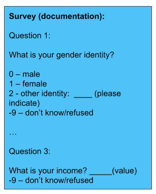

```{r setup, include=FALSE}

options(scipen = 999)

# library(tufte)

library(png) # png

library(grid)

# library(WDI) # for accessing World Bank data

library(ggplot2)

library(ggbeeswarm)

library(ggdist)

library(ggthemes)

library(viridis)

# library(ggmap) # maps

library(cowplot)

library(psych)

library(pander) # nice tables

library(maps)

library(choroplethr) # library for making maps

library(choroplethrMaps) # map data

```

```{r}

set.seed(3846)

N <- 100

age <- rnorm(N, 40, 10)

income <- rlnorm(N, 0, 1) * 10000 + 10000

group <- rbinom(N, 1, .2)

mental_health <- rnorm(N, 100, 15) + group * 3

group <- factor(group,
                levels = c(0,1),
                labels = c("Group A", "Group B"))

neighborhood <- cut(runif(N),
              c(0, 0.45, 0.90, 1), labels=FALSE)

neighborhood <- factor(neighborhood,
                 levels = c(1,2,3),
                 labels = c("Neighborhood A", 
                            "Neighborhood B", 
                            "Neighborhood C"))

mydata <- data.frame(age, mental_health, group, neighborhood)

```

# Possibilities

```{r}
#| eval: true
#| fig-cap: "possible visualizations"

img <- readPNG("banner.png")

grid.raster(img)

```

# Background

::: {.incremental}
* Deciding upon the right data visualization to represent your data can be a daunting process.
* I believe that a *starting point* for this thinking is some basic statistical thinking about the *type* of variables that you have. 
* At the broadest level, variables may be conceptualized as *categorical* variables, or *continuous* variables.
:::

# Data Often Come From A Survey Questionnaire.



# What is Data? {.smaller}

A data set is nothing more than a series of rows and columns that contain answers to responses to a survey.

::: {.incremental}
* Rows are usually used for individuals, while columns indicate the
questionnaire answers, or measures, from those people.
* Answers to questions are often given numerical responses (e.g. "no" is frequently coded as "0" and "yes" is frequently coded as "1")
:::

```{r}
#| label: tbl-hypothetical
#| tbl-cap: "hypothetical data"

person <- c(1,2,3)

Q1 <- c(1,2,1)

Q2 <- c(0,0,1)

Q3 <- c(100, 200, -9)

sample_dataset <- data.frame(person, Q1, Q2, Q3)

pander(sample_dataset)

# sample_dataset

```

## Some Notes on Data {.smaller}

::: {.incremental}
* In working through our research questions, we'll constantly be going back and forth between the actual data (to see the pattern of responses) and the documentation, to figure out the actual question asked as well as how the different responses are coded.
* Often in a spreadsheet, you'll see the full text of a question written out (e.g. "What is your gender identity"?)
* Most programs that work with data are going to want abbreviations (e.g. "Q1" or "gender"") for the questions. These abbreviations should usually have no spaces and be 8 characters or less.
:::

## Missing Data {.smaller}

::: {.incremental}
* One cell of @tbl-hypothetical has a negative number.
* Frequently negative numbers are used to indicate what are called "missing values". A missing value is a response like "don't know"" or "refused to answer" or "did not answer". 
* Before we start doing calculations with our data, we'll want to change negative numbers to true missing values (usually symbolized by a "." or "NA", so that they don't goof up our calculations.)
:::

# What are Variables?

::: {.incremental}
* By variables, I simply mean the columns of data that you have.
* For our purposes, you may think of variables as synonymous with questionnaire items, or columns of data.
:::

## Variable Types

::: {.incremental}
* *categorical variables* represent unordered categories like *neighborhood*, or *religious affiliation*, or *place of residence*.
* *continuous variables* represent a continuous scale like a *mental health scale*, or a *measure of life expectancy*.
:::

# A Data Visualization Strategy {.smaller}

Once we have discerned the *type of variable* that we have, there are some follow-up questions that we should ask before deciding upon a chart strategy. These questions have to do with the number of *dimensions* of our data that we are trying to visualize. Usually, we are trying to visualize only 1 or 2 dimensions of the data:

::: {.incremental}
* Is our graph about **one thing at a time**?
     + How much of *x* is there? 
     + What is the distribution of *x*?
* Is our graph about **two things at a time**?
     + What is the relationship of *x* and *y*?
     + How are *x* and *y* associated?
:::

## More On Strategy

```{r}

x <- rnorm(100, 100, 10)

z <- rbinom(100, 1, .5)

z <- factor(z, 
            levels = c(0,1),
            labels = c("Group A", "Group B"))

```

```{r}
#| eval: TRUE
#| fig-height: 5
#| fig-cap: "a data visualization strategy"

ggplot(data = NULL,
       aes(x = x)) +
  stat_dots(aes(fill = z), position = "dodge", alpha = 1.0) +
  geom_label(aes(x = 125, y = .2), label="Key \nTakeaway") +
  scale_fill_manual(name = "some other \npiece of \ninformation", 
                    values = c("darkblue", "gold")) +
  ylab("possibly another \ndimension of the data") +
  xlab("one dimension of the data") +
  labs(title = "Informative Title",
       subtitle = "Maybe The Title Is Even Your Main Takeaway",
       caption = "Every extra 'dimension' (x axis, y axis, color, shape) \n can convey an extra piece of information. \n Words should be spelled out.") + 
  theme_minimal() +
  theme(title = element_text(size = rel(1.25)),
        plot.caption = element_text(size = rel(1.25)),
        axis.text.y = element_blank()) +
  guides(fill = guide_legend(override.aes = list(size = 5)))

```

# Simulated Data {.smaller}

This example uses simulated data on social work clients, of the kind that a social service agency might collect.

```{r}
#| eval: FALSE
#| echo: FALSE

pander(describe(mydata, 
                skew = FALSE,
                ranges = FALSE),
       caption = "Descriptive Statistics")

```

```{r}
#| eval: TRUE
#| tbl-cap: "first few lines of data"
#| label: tbl-simulated

# head(mydata)

pander(head(mydata, 3),
       caption = "Simulated Data")

```

# Show One Thing At A Time 

We start by visualizing one indicator at a time.

## Continuous Variable {.smaller}

Sometimes the most interesting visualizations, are visualizations that give us a sense of the maximum, minimum, and average values.  For example, the *histogram* and *dotplot* display information on *age*.

```{r}
#| fig-cap: "histogram and dotplot"

p1 <- ggplot(mydata, 
             aes(x = age)) +
  labs(title = "Distribution of Age") +
  theme_minimal()
  
p1a <- p1 + 
  geom_histogram(fill = "darkblue") 

# p1a

p1b <- p1 + 
  stat_dots(fill = "darkblue") +
  ylab("") +
  theme_minimal() +
  theme(axis.title.y = element_blank(),
        axis.text.y = element_blank(),
        axis.ticks.y = element_blank())

# p1b 

plot_grid(p1a, p1b)

# ggsave("p1.png", p1)

```


## Categorical Variable {.smaller}

We would use a slightly different visualization, for example, a barchart, when our data are grouped into categories.

```{r}
#| fig-cap: "barchart with counts by neighborhood"

p2 <- ggplot(mydata,
             aes(x = neighborhood,
                 fill = neighborhood)) +
  geom_bar() + 
  labs(title = "Neighborhood") +
  scale_fill_manual(values = c("darkblue", 
                               "gold", 
                               "darkgreen")) +
  theme_minimal()

p2

```

# Show The Relationship Of Two Things 

Our task becomes somewhat more complicated when we want to understand the relationship of *one thing* to *another thing.*

## Categorical by Categorical {.smaller}

Here, for example, we visualize two *categorical* variables, *neighborhood*, by *group*. In this graph, the height of the bars represents the *count* of observations.

```{r}
#| fig-cap: "barchart with counts by neighborhood and by group"

p3 <- ggplot(mydata,
             aes(x = neighborhood, 
                 fill = neighborhood)) +
  geom_bar() +
  facet_wrap(~group) +
  coord_flip() + 
  labs(title = "Neighborhood",
       subtitle = "by Group") +
    scale_fill_manual(values = c("darkblue", 
                               "gold", 
                               "darkgreen")) +
  theme_minimal() +
  theme(strip.text = element_text(size = 8))

p3

```

## Continuous by Continuous {.smaller}

Here, we visualize two *continuous* variables, *mental health*, by *age*. 

```{r}
#| fig-cap: "scatterplot"

p4 <- ggplot(mydata,
             aes(x = age, y = mental_health)) + 
  geom_point(color = "darkblue") +
  geom_smooth(color = "red") +
  labs(title = "Mental Health by Age") +
  ylab("mental health")  +
  theme_minimal()

p4

```

## Continuous by Categorical {.smaller}

Last, we visualize a *continuous* variable by a categorical variable, *mental health*, by *group*. In this graph, the height of the bars represents the *mean score*.

```{r}
#| fig-cap: "barchart with means of mental health by group"

p5 <- ggplot(mydata,
             aes(x = group,
                 y = mental_health,
                 fill = group)) +
  stat_summary(fun = mean, 
               geom = "bar") + 
  coord_flip() +
  labs(title = "Mental Health by Group") + 
  ylab("mental health") +
  scale_fill_manual(values = c("darkblue", 
                               "gold")) +
  theme_minimal()

p5

```

# Show Where Something Is 

Sometimes our task is different. We want to visualize information, but add information on spatial location, using a map.

## Map {.smaller}

```{r}
#| fig-cap: "map"

world <- map_data("world")

world$myfill <- "no clients"

world$myfill[world$region == "Canada"] <- "clients"

world$myfill[world$region == "USA"] <- "clients"

world$myfill[world$region == "Mexico"] <- "clients"

mymap <- ggplot() + 
  geom_polygon(data = world, aes(x=long, 
                                 y = lat, 
                                 group = group,
                                 fill = myfill),
               color = "grey") + 
  labs(title = "Location of Agency Clients") +
  scale_fill_manual(name = "locations",
                    values = c("gold",
                               "darkblue")) +
  theme_minimal()  + 
  coord_fixed(1.3) 

mymap

```

# Conclusion

::: {.incremental}
* Data visualization can become complicated. 
* However, *good basic data visualization* begins with:
    + Understanding *the nature of our variables*. 
    + Understanding *how many dimensions of the data* we are trying include in a single visualization.
:::

# Credits 

Graphics made with the ggplot2 [@ggplot] graphing library created by Hadley Wickham.

```{r make_banner}
#| output: false

banner <- plot_grid(p1b + 
                      theme(plot.title=element_text(size = 20)), 
                    p2 + 
                      theme(plot.title=element_text(size = 20),
                            axis.text.x = element_blank()), 
                    p3 + 
                      theme(plot.title=element_text(size = 20)), 
                    p4 + 
                      theme(plot.title=element_text(size = 20)), 
                    p5 + 
                      theme(plot.title=element_text(size = 20)), 
                    nrow = 2,
                    mymap)

save_plot("banner.png", 
          banner,
          ncol = 3,
          nrow = 2)

```

# References


